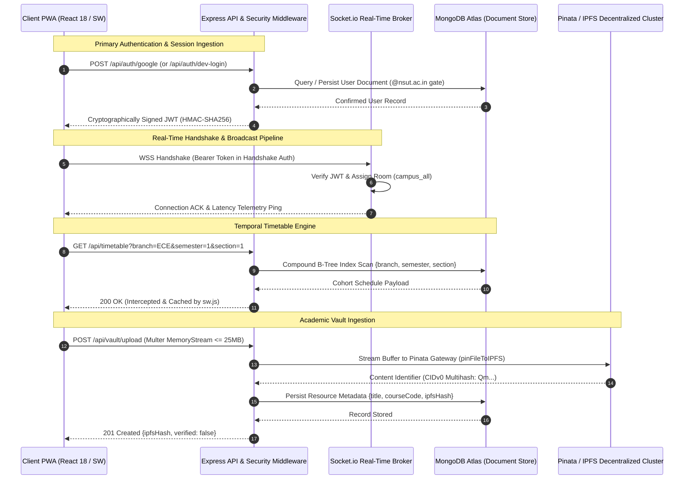

# CrossNexus // Master Technical Specification & Architecture Manual

**System Identity:** CrossNexus — Campus Intelligence, Decentralized Academic Vault, and Real-Time Telemetry Platform  
**Institutional Authority:** Crosslinks, Netaji Subhas University of Technology (Sector 3, Dwarka, New Delhi)  
**System Classification:** Production Campus Operating System & High-Performance Academic Network  
**Repository Coordinates:** [`https://github.com/ManitShukla/CrossNexus`](https://github.com/ManitShukla/CrossNexus)  
**Production Gateway:** [`https://crossnexus.vercel.app`](https://crossnexus.vercel.app)  
**Core API Gateway:** [`https://nsut-connect.onrender.com`](https://nsut-connect.onrender.com)  

---

## 1. System Header & Executive Overview

### 1.1 Abstract

CrossNexus is an event-driven, domain-isolated campus operating system engineered for Netaji Subhas University of Technology (NSUT). Built on a monolithic multi-tier monorepo architecture, the platform unifies real-time institutional broadcasts, an $O(1)$ compound-indexed temporal timetable resolution engine, a peer-to-peer decentralized study vault powered by the InterPlanetary File System (IPFS), and an offline-resilient Progressive Web App (PWA) runtime.

The system resolves fundamental friction points in collegiate operations: information fragmentation across unverified messaging channels, scheduling latency during transient connectivity outages, single-point-of-failure document hosting, and security vulnerabilities associated with public identity leakage. CrossNexus enforces strict zero-trust institutional boundary gates via Google OAuth 2.0 restricted to `@nsut.ac.in` credentials, paired with stateless JSON Web Tokens (JWT) and Role-Based Access Control (RBAC).

### 1.2 System Architecture Topology

The application operates on a dual-protocol transport layer where stateless HTTP REST transactions run in parallel with a stateful bidirectional WebSocket pipeline over an authenticated TCP connection.



---

## 2. Design System & Frontend Philosophy

### 2.1 Brutalist FUI Specification (`design.md`)

CrossNexus deliberately rejects contemporary consumer software design tropes—such as skeuomorphic drop shadows, saturated pastel gradients, expansive border radii, and low-contrast grey palettes. These conventions introduce unnecessary spatial overhead, reduce typographical information density, and degrade legibility in challenging physical campus environments (e.g., bright sunlight on campus lawns, dimly lit lecture auditoriums).

The visual language adheres to a **Military-Specification (Mil-Spec) HUD / Tactical Fictional User Interface (FUI)** design philosophy:

```
+-----------------------------------------------------------------------------+
| CROSSNEXUS // CAMPUS OS            [SYS_STATUS: NOMINAL]      14:32:01 UTC  |
+-----------------------------------------------------------------------------+
|                                                                             |
| +--[ COHORT: ECE / SEM 1 / SEC 1 ]----------------------------------------+ |
| | [ACTIVE CLASS // HAPPENING NOW]                                         | |
| | COURSE: EC101 // ANALOG ELECTRONICS                WINDOW: 14:00 - 15:00| |
| | LOCATION: ROOM 204 // LAB BLOCK 2                  INSTRUCTOR: DR. ROY  | |
| | PROGRESS: [ ■■■■■■■■□□ ] 80% ELAPSED               ENDS IN: 12 MINS     | |
| +-------------------------------------------------------------------------+ |
|                                                                             |
+-----------------------------------------------------------------------------+
```

#### Sensory Token Architecture & Chromatic Tokens

| Semantic Token | Hex Code | Purpose & Functional Context |
| :--- | :--- | :--- |
| `Canvas Base` | `#000000` | True-black foundational canvas maximizing OLED efficiency and contrast |
| `Panel Surface` | `#070707` / `#0d110f` | Charcoal container backgrounds for structural grouping and panel demarcation |
| `Phosphor Green` | `#cfff04` | Primary operational indicator, active states, reticles, verified attestations |
| `Tactical Teal` | `#00e5ff` | Telemetry metadata, course codes, non-critical status badges, countdown labels |
| `Hazard Amber` | `#ffb700` | High-priority warnings, urgent administrative announcements, intermediate thresholds |
| `Alert Red` | `#ff003c` | Critical alerts, domain unauthorized security rejections, destructive vectors |
| `Stroke Dim` | `#1c2420` | Subtle hairline dividers, secondary borders, inert structural framing |
| `Stroke Bright` | `#2a3832` | Elevated hairline borders on active or focused interactive surfaces |

#### Architectural Constraints
1. **Global Zero Border-Radius:** Every graphical container, button, modal dialog, and input element enforces `border-radius: 0px`. This guarantees maximal display utilization and alignment with Cartesian coordinate grids.
2. **Hairline Geometric Framing:** Structural borders are constrained to 1px thickness (`border-stroke-dim`, `border-stroke-bright`, `border-phosphor`). Panels feature corner reticles (`.fui-reticle-tl`, `.fui-reticle-tr`, `.fui-reticle-bl`, `.fui-reticle-br`) to convey instrumentation calibration.
3. **Monospaced Typography:** Interface typography is bound to fixed-width fonts (`JetBrains Mono`, `Space Mono`). Numerical telemetry, military time designations (`14:00 - 15:00`), IPFS hashes (`QmXoyp...`), and countdown tickers use tabular figures (`tabular-nums`) to prevent horizontal jitter during real-time value changes.
4. **Mechanical Transitions:** Animated state changes reject soft easing curves in favor of high-velocity micro-transitions: $100\text{ms}$ linear transitions or $150\text{ms}$ cubic-bezier curves (`cubic-bezier(0.2, 0.8, 0.2, 1)`). Rotational loaders are discarded in favor of monospace telemetry tickers (`[ AWAITING TELEMETRY █ ]`, `[ ■■■■■□□□ ]`).

---

## 3. Subsystem Architecture & Technical Implementation

### A. Domain-Restricted Authentication & Access Control

```
+------------------+      +-------------------+      +--------------------+
|  Browser Client  | ---> |  Passport.js Auth | ---> | Google OAuth 2.0   |
|  (@nsut.ac.in)   | <--- |  Security Filter  | <--- | Identity Provider  |
+------------------+      +-------------------+      +--------------------+
                                    |
                                    v
                     +-----------------------------+
                     | Canonical Domain Validator  |
                     | /^[a-zA-Z0-9._%+-]+         |
                     |  @nsut\.ac\.in$/            |
                     +-----------------------------+
                                    |
                    +---------------+---------------+
                    | Match                         | Fail
                    v                               v
         +--------------------+          +---------------------+
         | Stateless JWT      |          | HTTP 403 / Redirect |
         | HS256 Signed Token |          | "UNAUTHORIZED_      |
         +--------------------+          |  DOMAIN"            |
                                         +---------------------+
```

#### 1. OAuth Pipeline & Boundary Enforcement
Authentication is governed by `passport-google-oauth20` inside `server/config/passport.js`. The identity ingestion pipeline enforces an institutional domain filter before persisting or authenticating records:

$$\text{Regex Pattern: } \texttt{\textasciicircum[a-zA-Z0-9.\_\%+-]+@nsut\textbackslash.ac\textbackslash.in\$}$$

Any identity asserting an address outside the canonical NSUT domain (e.g., standard consumer `@gmail.com` accounts) is rejected at the passport verification layer, returning an explicit `UNAUTHORIZED_DOMAIN` error condition and aborting session creation.

#### 2. Stateless Cryptographic JWT Issuance
Upon successful domain verification, the server issues a cryptographically signed JSON Web Token via `server/controllers/authController.js`:

```javascript
const signToken = (user) => {
  return jwt.sign(
    {
      id: user._id || user.id,
      email: user.email,
      role: user.role,
      branch: user.branch || null,
      name: user.name || null,
    },
    JWT_SECRET,
    { expiresIn: '7d' }
  );
};
```

Tokens are verified in flight via `server/middleware/authMiddleware.js`. Inbound requests must supply the token within the standard HTTP `Authorization` header (`Bearer <token>`) or as an authenticated WebSocket handshake payload.

#### 3. Role-Based Access Control (RBAC)
Authorizations are tiered across two distinct privilege rings: `student` and `admin`. Administrative routes (such as notice creation, notice deletion, and academic resource attestation) are protected by the `requireAdmin` sentry middleware (`server/middleware/roleMiddleware.js`):

```javascript
const requireAdmin = (req, res, next) => {
  if (!req.user || req.user.role !== 'admin') {
    return res.status(403).json({
      status: 'FORBIDDEN',
      code: 'INSUFFICIENT_CLEARANCE',
      message: 'Action restricted to verified campus administrators.',
    });
  }
  next();
};
```

Institutional administrative addresses (configured via `ADMIN_EMAILS`) are resolved during identity ingestion, preventing manual privilege escalation.

---

### B. Real-Time Telemetry & WebSocket Engine

#### 1. Server Architecture & Handshake Guard
Real-time messaging is implemented using Socket.io over an HTTP/1.1 and WebSocket transport (`server/sockets/announcementSockets.js`). Unauthenticated sockets are blocked at the connection boundary using an asynchronous authentication middleware (`io.use`):

```javascript
io.use(async (socket, next) => {
  try {
    const authHeader = socket.handshake.headers?.authorization;
    const token = socket.handshake.auth?.token || (authHeader && authHeader.replace(/^Bearer\s+/i, ''));
    if (!token) return next(new Error('AUTHENTICATION_FAILED: Session token missing.'));

    const decoded = jwt.verify(token, JWT_SECRET);
    socket.user = decoded;
    next();
  } catch (err) {
    next(new Error(`AUTHENTICATION_FAILED: ${err.message}`));
  }
});
```

#### 2. Room Topologies & Broadcast Channels
* **Universal Broadcast (`campus_all`):** Every authenticated socket is automatically assigned to the global `campus_all` room upon handshake completion. Institutional announcements posted by administrators trigger an atomic dispatch: `io.to('campus_all').emit('new_announcement', payload)`.
* **Scoped Branch Channels (`branch_<BRANCH>`):** Sockets belonging to users with calibrated academic branches (e.g., `ECE`, `CSE`) are assigned to discrete branch rooms, enabling targeted notifications.

#### 3. Client Reception & Synthetic Audio Telemetry
Inbound transmissions are captured client-side by `client/src/context/SocketContext.jsx` and rendered through `<IncomingTransmissionToast/>` (`client/src/components/common/IncomingTransmissionToast.jsx`).

To alert students in loud campus settings without loading heavy external media files, the notification component uses the **Web Audio API** to generate synthetic acoustic alerts:
* **Standard Priority Transmissions:** Dual-tone square wave shifting from $720\text{Hz}$ to $1080\text{Hz}$ over $80\text{ms}$ with exponential gain decay.
* **Critical / Urgent Transmissions:** Sawtooth wave shifting from $960\text{Hz}$ to $1440\text{Hz}$ over $80\text{ms}$ with rapid gain attenuation.
* **Visual Exit Transition:** $150\text{ms}$ `cubic-bezier(0.2, 0.8, 0.2, 1)` mechanical slide along the X-axis (`translate-x-12 opacity-0`).

---

### C. Smart Timetable Engine & Temporal Arithmetic

#### 1. Compound Indexing Architecture
Schedules are stored in MongoDB using cohort-specific arrays (`server/models/Timetable.js`). Query resolution performance is guaranteed by a compound unique index:

```javascript
timetableSchema.index({ branch: 1, semester: 1, section: 1 }, { unique: true });
```

This compound index ensures $O(1)$ B-Tree resolution when querying a specific student cohort (`branch=ECE&semester=1&section=1`), preventing sequential collection scans across large student bodies.

#### 2. Temporal "Happening Now" State Machine
The client-side schedule tracker (`client/src/components/timetable/CurrentSlotCard.jsx`) evaluates the system clock every second against scheduled lecture windows:

```
[System Time: HH:mm:ss]
        |
        v
Convert to Day & Minute Offsets:
  currentMinutes = getHours() * 60 + getMinutes()
        |
        +---> [Is Weekend? (Sat/Sun)] ---> Render "Dormant / Standby" & Look-ahead to Monday
        |
        +---> [Active Slot Evaluation]
        |       start <= currentMinutes < end
        |       |
        |       +---> MATCH:
        |       |       duration = end - start
        |       |       elapsed = currentMinutes - start
        |       |       percent = round((elapsed / duration) * 100)
        |       |       remaining = end - currentMinutes
        |       |       Render [ACTIVE CLASS // HAPPENING NOW] with segmented ticker
        |       |
        |       +---> NO MATCH:
        |               Find next chronological slot where start > currentMinutes
        |               Render [FREE PERIOD / RECESS] with time-to-next countdown
```

#### Chronological Arithmetic Formulas

$$\text{Minutes From Midnight: } M(t) = t_{\text{hours}} \times 60 + t_{\text{minutes}}$$

$$\text{Elapsed Session Percentage: } P = \min\left(100, \max\left(0, \left\lfloor \frac{M_{\text{current}} - M_{\text{start}}}{M_{\text{end}} - M_{\text{start}}} \times 100 \right\rfloor\right)\right)$$

$$\text{Time Remaining: } R_{\text{minutes}} = M_{\text{end}} - M_{\text{current}}$$

#### Edge Condition Resolution
* **Contiguous Lectures:** If a lecture concludes at `10:00` and another begins at `10:00`, the boundary condition ($M_{\text{start}} \le M_{\text{current}} < M_{\text{end}}$) transitions between classes at $10:00:00$ without dead-zone states.
* **Off-Hours & Recess Periods:** When no slot matches the active range, the algorithm scans for the next available slot for the day. If all classes for the day have finished, the card switches to dormancy mode.
* **Weekend Inversion:** On Saturdays and Sundays, the engine suspends weekday checks, highlights a dormant indicator, and performs a look-ahead scan to show the earliest lecture for the upcoming Monday.

---

### D. Academic Vault & Decentralized Storage (IPFS)

#### 1. File Ingestion Pipeline
Document uploads are processed via `server/routes/vaultRoutes.js` using `multer` configured exclusively for in-memory streaming:

```javascript
const storage = multer.memoryStorage();
const upload = multer({
  storage,
  limits: { fileSize: 25 * 1024 * 1024 }, // 25 MB ceiling
});
```

Memory buffers are streamed directly to Pinata's pinning gateway API (`https://api.pinata.cloud/pinning/pinFileToIPFS`). Raw files bypass server disk writes, preventing temporary file accumulation and disk exhaustion attacks.

#### 2. Deterministic Cryptographic Fallback Engine
When Pinata API keys are unavailable (such as in local or offline environments), `server/config/ipfs.js` runs a local cryptographic engine that generates compliant IPFS Content Identifiers (CIDv0):

```javascript
function computeDeterministicIpfsCid(buffer) {
  const sha256Digest = crypto.createHash('sha256').update(buffer).digest();
  const multihash = Buffer.concat([Buffer.from([0x12, 0x20]), sha256Digest]);
  return toBase58(multihash);
}
```

* Prefix `0x12` denotes the standard SHA-256 multihash algorithm code.
* Prefix `0x20` denotes a 32-byte hash length (256 bits).
* The 34-byte payload is encoded using the standard Bitcoin/IPFS Base58 alphabet:
  $$\text{Alphabet: } \texttt{123456789ABCDEFGHJKLMNPQRSTUVWXYZabcdefghijkmnopqrstuvwxyz}$$

The resulting hash (e.g., `QmXoypizjW3WknFiJnKLwHCnL72vedxjQkDDP1mXWo6uco`) produces an immutable 46-character string matching the IPFS CIDv0 specification, allowing full vault functionality during local testing without external cloud dependencies.

#### 3. Administrative Attestation Mechanism
Uploaded files default to `verified: false`. Verified faculty and campus administrators can cryptographically attest to documents using `PATCH /api/vault/:id/verify`. Documents verified by administrators display an attestation reticle: `[VERIFIED]`.

---

### E. Progressive Web App & Offline Continuity (Service Worker)

```
[ Client Request ]
       |
       v
+-------------------+
|  Service Worker   |
|     (sw.js)       |
+-------------------+
       |
       +---> Method !== 'GET' or URL matches '/socket.io'? ---> [ Direct Network Pass-Through ]
       |
       +---> URL matches '/api/timetable'?
       |        |
       |        v
       |     [ Network-First Strategy ]
       |        |
       |        +---> Network OK? ---> Update 'crossnexus-timetable-cache-v1' ---> Return Fresh Schedule
       |        |
       |        +---> Network Drop? ---> Intercept ---> Return Cached Cohort Payload
       |
       +---> Static Assets (HTML / JS / CSS / Icons)?
                |
                v
             [ Cache-First / Stale-While-Revalidate ]
```

#### 1. Manifest Specification (`client/public/manifest.json`)
The application is configured for standalone installation across mobile and desktop environments:
* **Display Mode:** `standalone`
* **Theme Color:** `#070707`
* **Background Canvas:** `#000000`
* **Vector Maskable Icons:** Vector SVG format supporting dynamic densities from $192\times192$ to $512\times512$.

#### 2. Caching Policies & Lifecycle Management (`client/public/sw.js`)
* **Static Asset Pre-Caching (`crossnexus-static-v1`):** Pre-caches the application shell (`/`, `/index.html`, `/manifest.json`, `/icons/icon.svg`) during `install`, triggering `self.skipWaiting()` for immediate activation.
* **Obsolete Cache Eviction:** During `activate`, obsolete cache namespaces are purged before calling `self.clients.claim()`.
* **Exclusion Criteria:** State-mutating HTTP methods (`POST`, `PUT`, `DELETE`, `PATCH`) and real-time WebSocket protocol upgrades (`/socket.io`, `ws:`, `wss:`) are bypassed by the Service Worker to avoid breaking API operations.

#### 3. Network-First Schedule Caching
Because academic timetables update rarely but must remain available in basement classrooms or lecture halls with poor reception, `/api/timetable` uses a **Network-First with Cache-Fallback** strategy:
1. When online, the request fetches fresh data over the network and asynchronously updates `crossnexus-timetable-cache-v1`.
2. When offline or during network dropouts, the Service Worker intercepts the failed fetch and serves the cached cohort JSON payload.
3. If no matching cohort is cached, it serves the nearest available cohort schedule or returns an offline error payload with HTTP status 503.

#### 4. Client-Side Telemetry Banner
The `useOfflineTimetable` hook (`client/src/hooks/useOfflineTimetable.js`) monitors `navigator.onLine` and window network events (`online`, `offline`). If an offline condition is detected, `TimetablePage.jsx` renders a high-visibility hazard warning:

```
[ OFFLINE MODE ACTIVE // SHOWING LOCALLY STORED TIMETABLE ]
[ SNAPSHOT: 10:45:12 AM ]
```

---

## 4. Security Architecture & Data Privacy Engineering

### 4.1 Zero-PII Projection Scrubbing
To protect student privacy and comply with data protection standards, sensitive personal identifiers—such as Google IDs (`googleId`) and institutional email addresses (`email`)—are scrubbed at the database driver level.

Controllers apply projection whitelists across all `.populate()` calls before data is serialized into JSON:

```javascript
// server/controllers/announcementController.js
.populate('author', 'name role avatar');

// server/controllers/discussionController.js
.populate('author', 'name role branch avatar');

// server/controllers/vaultController.js
.populate('uploadedBy', 'name branch role avatar');
```

Public API payloads expose only the student's display name, academic branch, role, and avatar. Institutional email addresses are never leaked into the public discussion feeds or vault archives.

### 4.2 Concurrency Guards & Idempotent Upvoting
Standard read-modify-write patterns (`doc.upvotes.push(userId); await doc.save();`) suffer from write collisions under concurrent loads. CrossNexus avoids this vulnerability by using MongoDB's atomic **`$addToSet`** and **`$pull`** operators directly within `findByIdAndUpdate` (`server/controllers/discussionController.js`):

```javascript
const hasUpvoted = discussion.upvotes.some(id => id.toString() === userId.toString());
const updateQuery = hasUpvoted
  ? { $pull: { upvotes: userId } }
  : { $addToSet: { upvotes: userId } };

const updatedDiscussion = await Discussion.findByIdAndUpdate(
  id,
  updateQuery,
  { new: true }
).populate('author', 'name role branch avatar');
```

This operation executes atomically within MongoDB's storage engine using document-level locks. It guarantees mathematical idempotency and prevents race conditions, regardless of concurrent interactions.

### 4.3 Input Sanitization & Whitelisting
Departmental calibration forms (`/api/users/onboard`) validate user input against accredited university branches:

$$\text{Approved Academic Branches: } \{\texttt{CSE}, \texttt{CSAI}, \texttt{CSDS}, \texttt{IT}, \texttt{ITNS}, \texttt{MAC}, \texttt{ECE}, \texttt{EE}, \texttt{ICE}, \texttt{MECH}, \texttt{BT}, \texttt{CIVIL}, \texttt{DESIGN}\}$$

Inputs are forced to uppercase, trimmed, and checked against the whitelist. Invalid branches are rejected with HTTP 400 (`INVALID_BRANCH_CODE`), protecting against malformed database records.

---

## 5. Database Schema & Indexing Topology

```
+-------------------------------------------------------------+
|                          DATABASE                           |
+-------------------------------------------------------------+
           |
           +---> Users (Domain-locked Accounts)
           |
           +---> Announcements (Priority Broadcasts)
           |
           +---> Discussions & Comments (Threaded Feed)
           |
           +---> Timetables (Compound-indexed Cohort Matrices)
           |
           +---> Resources (IPFS Academic Vault Records)
```

### 5.1 `User` Schema
```javascript
{
  googleId:     { type: String, required: true, unique: true, index: true },
  name:         { type: String, required: true, trim: true },
  email:        { type: String, required: true, unique: true, index: true, lowercase: true, match: /^[a-zA-Z0-9._%+-]+@nsut\.ac\.in$/ },
  avatar:       { type: String, default: '' },
  role:         { type: String, enum: ['student', 'admin'], default: 'student' },
  branch:       { type: String, uppercase: true, default: null },
  semester:     { type: Number, min: 1, max: 8, default: null },
  section:      { type: String, uppercase: true, default: null },
  isOnboarded:  { type: Boolean, default: false },
  createdAt:    { type: Date, default: Date.now },
  updatedAt:    { type: Date, default: Date.now }
}
```

### 5.2 `Announcement` Schema
```javascript
{
  title:        { type: String, required: true, trim: true },
  body:         { type: String, required: true },
  category:     { type: String, enum: ['Exams', 'Placements', 'Administration', 'Events', 'General'], default: 'General' },
  priority:     { type: String, enum: ['low', 'medium', 'high', 'critical'], default: 'medium' },
  isPinned:     { type: Boolean, default: false },
  author:       { type: mongoose.Schema.Types.ObjectId, ref: 'User', required: true },
  attachments:  [{ filename: String, url: String }],
  createdAt:    { type: Date, default: Date.now }
}
// Compound Index: Priority retrieval for feed queries
announcementSchema.index({ isPinned: -1, createdAt: -1 });
```

### 5.3 `Discussion` & `Comment` Schemas
```javascript
// Discussion Document
{
  title:        { type: String, required: true, trim: true },
  body:         { type: String, required: true },
  channel:      { type: String, enum: ['General', 'Academics', 'Tech & Projects', 'Campus Life'], default: 'General' },
  author:       { type: mongoose.Schema.Types.ObjectId, ref: 'User', required: true },
  upvotes:      [{ type: mongoose.Schema.Types.ObjectId, ref: 'User' }],
  commentCount: { type: Number, default: 0 },
  createdAt:    { type: Date, default: Date.now }
}
discussionSchema.index({ channel: 1, createdAt: -1 });

// Comment Document (Hierarchical Adjacency List)
{
  discussionId: { type: mongoose.Schema.Types.ObjectId, ref: 'Discussion', required: true, index: true },
  author:       { type: mongoose.Schema.Types.ObjectId, ref: 'User', required: true },
  body:         { type: String, required: true },
  parentId:     { type: mongoose.Schema.Types.ObjectId, ref: 'Comment', default: null, index: true },
  createdAt:    { type: Date, default: Date.now }
}
```

### 5.4 `Timetable` Schema
```javascript
// Slot Subdocument
{
  day:          { type: String, enum: ['Monday', 'Tuesday', 'Wednesday', 'Thursday', 'Friday'], required: true },
  startTime:    { type: String, required: true, match: /^([01]\d|2[0-3]):[0-5]\d$/ }, // HH:mm 24h
  endTime:      { type: String, required: true, match: /^([01]\d|2[0-3]):[0-5]\d$/ }, // HH:mm 24h
  subjectCode:  { type: String, required: true, uppercase: true },
  subjectName:  { type: String, required: true },
  faculty:      { type: String, default: 'TBA' },
  room:         { type: String, required: true }
}

// Timetable Document
{
  branch:       { type: String, required: true, uppercase: true },
  semester:     { type: Number, required: true, min: 1, max: 8 },
  section:      { type: String, required: true, uppercase: true },
  schedule:     [slotSchema]
}
// Unique Cohort Resolution Index
timetableSchema.index({ branch: 1, semester: 1, section: 1 }, { unique: true });
```

### 5.5 `Resource` (Academic Vault) Schema
```javascript
{
  title:        { type: String, required: true, trim: true },
  courseCode:   { type: String, required: true, uppercase: true, index: true },
  type:         { type: String, enum: ['PYQ', 'Notes', 'Lab Manual', 'Syllabus'], required: true },
  ipfsHash:     { type: String, required: true, index: true },
  fileSize:     { type: Number, default: 0 },
  uploadedBy:   { type: mongoose.Schema.Types.ObjectId, ref: 'User', required: true },
  verified:     { type: Boolean, default: false, index: true },
  createdAt:    { type: Date, default: Date.now }
}
// Compound Filtering Index
resourceSchema.index({ courseCode: 1, type: 1, verified: -1 });
```

---

## 6. Verification Harness & Local Operation

### 6.1 Prerequisites & Toolchain
* **Node.js:** Runtime environment version `18.x` or `20.x` LTS
* **npm:** Package manager version `9.x` or higher
* **MongoDB:** Local instance or MongoDB Atlas cluster URI
* **Git:** Version control client

---

### 6.2 Environment Variable Dictionary

#### Backend Server Environment (`server/.env`)
```bash
# Server Network Binding
PORT=5000
NODE_ENV=development

# Allowed Origins and Base Routing
CLIENT_URL=https://crossnexus.vercel.app
BACKEND_URL=https://nsut-connect.onrender.com

# Persistence Uplink (MongoDB Atlas Cluster)
MONGODB_URI=mongodb+srv://<username>:<password>@cluster.mongodb.net/crossnexus?retryWrites=true&w=majority

# Cryptographic Signatures
JWT_SECRET=TACTICAL_ALPHA_KEY_SECURE_9812739182371982_CROSSNEXUS

# Google OAuth 2.0 Credentials (@nsut.ac.in Restricted)
GOOGLE_CLIENT_ID=your-google-client-id.apps.googleusercontent.com
GOOGLE_CLIENT_SECRET=your-google-client-secret
GOOGLE_CALLBACK_URL=https://nsut-connect.onrender.com/api/auth/google/callback

# Pinata IPFS Cluster Credentials (Optional: deterministic Base58btc fallback available)
PINATA_API_KEY=your_pinata_api_key
PINATA_SECRET_API_KEY=your_pinata_secret_api_key
```

#### Frontend Client Environment (`client/.env`)
```bash
# REST API Endpoint
VITE_API_URL=https://nsut-connect.onrender.com

# WebSocket Broker URL
VITE_SOCKET_URL=https://nsut-connect.onrender.com
```

---

### 6.3 Installation & Bootstrapping

#### 1. Clone Repository & Install Monorepo Dependencies
```bash
git clone https://github.com/ManitShukla/CrossNexus.git
cd CrossNexus

# Install root dependencies
npm install

# Install client and server packages
npm --prefix client install
npm --prefix server install
```

#### 2. Execute Automated Test Suites
Run the verification test suites covering all architectural layers:

```bash
# Execute master integration audit suite
node server/test_master_e2e_audit.js

# Execute progressive web app & service worker test harness
node server/test_phase7_pwa.js

# Execute IPFS vault & cryptographic multihash verification
node server/test_phase6_vault.js

# Execute end-to-end acceptance certification
node server/test_final_acceptance.js
```

#### 3. Build Client Production Bundle
```bash
npm --prefix client run build
```

#### 4. Launch Development Instances
Open two terminal windows to run both services:

```powershell
# Terminal 1: Launch Backend Engine
cd server
npm run dev
```

```powershell
# Terminal 2: Launch Frontend Client
cd client
npm run dev
```

* Frontend UI: `http://localhost:5173`
* Backend API & Telemetry: `http://localhost:5000`
* Health Check: `http://localhost:5000/health`

---

### 6.4 Local Telemetry Simulation Harness

To verify functionality without needing external Google Cloud OAuth credentials, the authentication interface (`client/src/pages/LoginPage.jsx`) includes a built-in simulation harness. This harness calls the `/api/auth/dev-login` endpoint to issue cryptographically signed, stateless JWT sessions directly from the development server:

```
+-------------------------------------------------------------------------------+
| [ SIMULATION & TEST HARNESS // INSTANT ACCESS ]                               |
|                                                                               |
| +-------------------------+ +-------------------------+ +-------------------+ |
| | <DEMO: LOGIN AS STUDENT>| | <DEMO: LOGIN AS ADMIN>  | | <TEST: GMAIL AUTH>| |
| | Student privileges:     | | Administrative access:  | | Simulates public  | |
| | Timetable, IPFS Vault,  | | Priority broadcasts,    | | email to verify   | |
| | Discussions             | | Material attestation    | | domain rejection  | |
| | ID: student@nsut.ac.in  | | ID: admin@nsut.ac.in    | | ID: test@gmail    | |
| +-------------------------+ +-------------------------+ +-------------------+ |
+-------------------------------------------------------------------------------+
```

1. **`<DEMO: LOGIN AS STUDENT>`:**
   Dispatches `POST /api/auth/dev-login` with payload `{ email: 'student.2024@nsut.ac.in', role: 'student' }`. The backend issues a verified JWT with student privileges, bypassing Google OAuth while establishing a functional session to test schedules, discussions, and vault downloads.
2. **`<DEMO: LOGIN AS CAMPUS ADMIN>`:**
   Dispatches `POST /api/auth/dev-login` with payload `{ email: 'admin.terminal@nsut.ac.in', role: 'admin' }`. Generates an elevated administrative session to test notice broadcasts and resource verification.
3. **`<TEST: ATTEMPT @GMAIL.COM LOGIN>`:**
   Sends an unauthorized identity (`intruder@gmail.com`) to the authentication gate. Tests that the domain filter rejects the attempt and triggers the access denial interface (`[ ACCESS DENIED // UNAUTHORIZED DOMAIN: ONLY @nsut.ac.in ACCOUNTS PERMITTED ]`).

---

*CrossNexus Architecture Specification // Maintained by Crosslinks, Netaji Subhas University of Technology*
